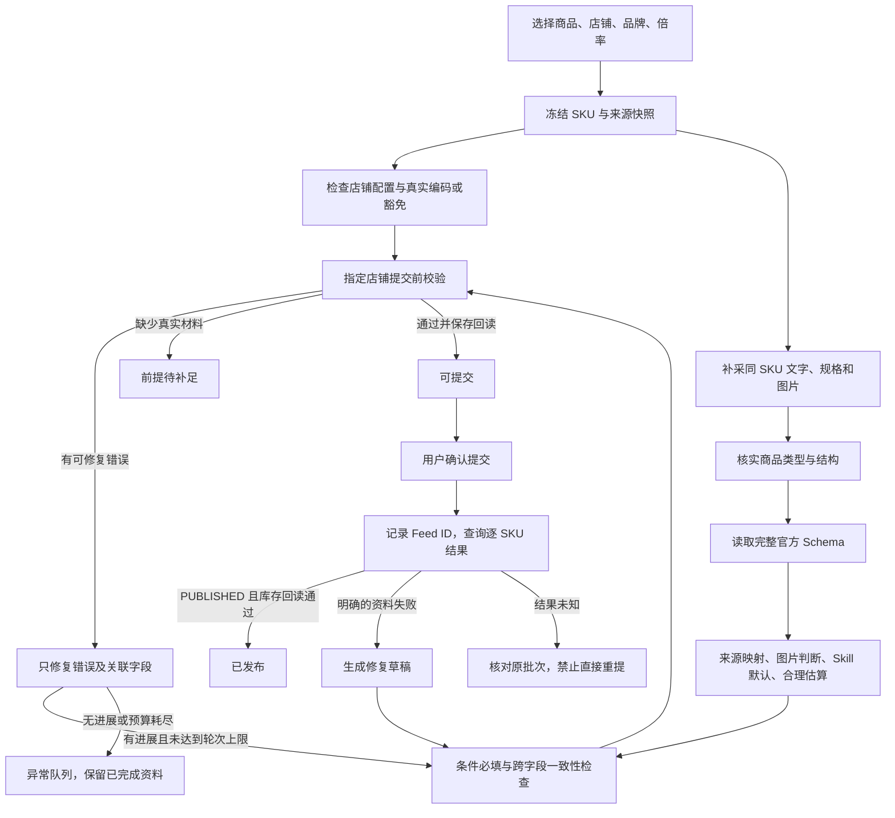

# AI 自动刊登资料与校验闭环设计

设计日期：2026-11-17。状态：首版已实现，尚未进行真实商品的模型识图与正式刊登验收。

## 目标与交付边界

用户选择商品、目标店铺、品牌和价格倍率后，系统自动准备所有适用必填项，完成指定店铺的提交前校验，展示「可提交」。用户确认提交后，记录沃尔玛批次，查询逐 SKU 处理结果，对明确失败的资料生成修复版本。

「生成结束」「可提交」「沃尔玛已接收」「已发布」是不同结果。只有平台返回 PUBLISHED 且当前 SKU 库存回读通过，才标记已发布。本地完整性校验不能承诺最终平台审核结果。

产品体验以无需逐字段人工填写为目标。真实编码、已批准豁免、授权等外部材料由来源同步或一次性配置提供；缺少这些材料时归入「前提待补足」，不能靠随机条码或虚构证明显示成功。非适用、非必填的空字段不为追求填满而写入无关值。

## 现状与增量

| 环节 | 当前项目能力 | 本方案增加 |
| --- | --- | --- |
| 来源 | SKU 对应的文字、规格、价格库存快照 | 生成前检查资料完整性，缺项按 SKU 定向补采 |
| 图片 | 图片管理、服务器目录存储、公网签名访问 | 选取主图、细节图和尺寸图输入 AI，记录图片证据 |
| 类目与属性 | 官方类目、Schema、来源映射、Skill 默认和普通估算 | 联合检查商品结构与条件属性，纠正可证明未被人工修改的旧 AI 结果 |
| 生成任务 | 持久化任务、版本/店铺/来源保护、保存回读 | 分阶段进度、定向修复轮次、明确的 SKU 完成状态 |
| 商品编码 | 编码校验、已知申请编号的豁免核验 | 真实编码匹配、编码池、豁免发现或预先绑定 |
| 提交前校验 | `/validate` 可查询实际店铺并生成校验报告 | 生成后自动调用相同校验服务，形成错误反馈闭环 |
| 提交与结果 | 确认提交、Feed ID、主动查询、库存回读、防重复 | 可恢复的后台查询、资料错误分类和修复草稿 |

## 完整流程

生成按钮只负责准备和校验资料，不触发正式刊登。库存更新继续只在既有已确认提交的流程中进行。

## 来源补全与图片理解

每个任务绑定 `source_system + source_sku + listing_id + platform_sku + store_id + partner_id`，保存来源版本、资料版本、规则版本、模型配置标识和 Schema 摘要。不同平台同名 SKU 不合并，子 SKU 不借用父商品或其他变体的规格、图片和价格。

来源补全按缺项调用已有来源适配器。大建云仓读取当前 SKU 的完整详情及包装资料；亚马逊仅使用核验身份后的对应 ASIN 资料。需要人工验证码时沿用已有人工验证通道，任务保存进度并暂停相关补采，不绕过验证。来源响应中的文字只作为资料，不执行其中的指令。

补采发生在生成输入冻结之前。修复途中确需补采时，先核对原来源版本、店铺与资料 revision 未被其他操作改变，再显式采用新来源快照、更新任务依据并使旧校验失效，不能混用新事实与旧 basis。外部任务在此期间修改来源仍触发既有冲突保护。缓存依据使用规范化后的实际内容及图片摘要，不因无关的抓取时间改变而重复调用模型。

图片输入先验证当前 API 与模型确实支持图片消息及稳定的结构化输出。能力未通过时显示具体能力异常，不把文字回复当成识图结果，也不私自切换提供商。首版每 SKU 最多选择6张：主图1张、结构细节图最多3张、尺寸/包装标注图最多2张；已足够判断时减少图片数量。

图片优先通过现有存储层转为稳定资产，保留原图，识别使用独立缩放副本。资产用 SHA-256 去重，记录同 SKU 归属、原始来源、抓取时间和尺寸；商品已有发布图片的增删、顺序不随识图改变。公网图片下载复用受控入口，验证重定向后的地址、实际格式和大小，不能访问本机或内网。模型凭证和来源登录信息不传入图片 URL。

图片结论分为两种：清晰标签/OCR并经规则确认的规格记为图片标签证据；对结构、样式、材质外观的判断记为视觉推断。每项关联具体图片摘要、依据、局限和真实置信度。不能从普通照片猜精确尺寸、包装重量、认证、产地或条码；模糊标签不能作为真实编码来源。

## 类目、结构与填写策略

首先在当前店铺真实候选中选择商品类型，等待完整规格可用后再填写。不能为了减少必填项选择错误类目。生成器根据当前值重新计算 `if/then`、组合约束及依赖字段，不能只校验固定 required 列表。

每个适用字段依次尝试：同 SKU 的明确文字/标签事实及单位换算 → 可解释的语义映射或视觉判断 → 用户已授权的 Skill 默认值 → 有上下文依据的普通属性估算。来源冲突先核实，不以默认值掩盖冲突。默认及估算均须符合当前 Schema 的真实字段、类型、枚举、范围和精度。

沿用现有 Skill 默认，包括缺失时的 Adult、China、No、Imported、备货1、净内容1 Each/Case等，记录 user_rule；保留已有有效值与数量。22英寸只作为缺失长度的最后兜底，不能代替离散床型，也不能用于重量、库存、价格或条码。默认值通过格式检查不代表其属于供应商提供的事实。

普通物理/款式字段可以由 AI 判断，不能只因来源没有逐字出现枚举名称就拒填。需要同时输出字段值、证据引用、判断类型、理由和真实置信度。没有合理依据时进入补采或异常队列，禁止用任意选项通过检查。认证号、真实型号、价格、实际库存和批准信息不得估算。

当前示例按以下规则处理：

| 问题 | 自动处理方式 | 禁止方式 |
| --- | --- | --- |
| Modular 与 Sleeper | 联合标题、规格、主图、床结构图判断；二者可能同时成立。只凭一句营销词的旧 AI 结果需复核 | 为避开 bedSize 删除真实的 Sleeper，或把所有组合沙发都断言为非床型 |
| 床尺寸 | 对真实床型优先读取睡眠区域尺寸、床垫适配标签；有明确非标准尺寸依据时才选择实际 Non-Standard 选项 | 将整张沙发外形尺寸当床面；因未知就选择 Non-Standard；把22英寸写入 Queen/Twin 枚举 |
| 靠背软垫款式 | 结合背部结构、是否独立靠垫、可拆卸证据及实际枚举做语义/视觉判断 | 所有沙发统一选 Cushion Back 或 Loose Back |
| EAN/UPC/GTIN | 匹配真实编码或准确的已批准豁免 | 随机生成可通过校验位的数字；用供应商 SKU 充当 EAN |

此前由 AI 生成且当前值与生成记录完全一致的字段，允许在新增证据支持时修正，记录旧值与新依据。手工编辑字段锁定；系统发现矛盾时指出具体冲突，不静默覆盖。没有来源标记的历史值按人工内容保护。改变商品类型后，只移除官方规格明确不接受的旧字段，原值保留审计。

## 真实编码与豁免

真实编码路径：读取已验证的本商品编码 → 核实格式、校验位、品牌与包装层级 → 核对产品归属 → 绑定并保存。保留前导零，不使用随机数、ASIN 或平台 SKU 替代。来源品牌与本批目标品牌不一致时不能直接认为供应商编码适用于新品牌。

编码池只允许管理员导入具有真实归属依据、可用于目标品牌/商品的编码。分配由数据库事务完成，防止并发把同一编码分配给不同商品；有活动预留的记录重试继续复用，任务崩溃后先恢复绑定，不盲目回收。商品身份、品牌及包装层级相同的跨店铺刊登可引用同一真实编码，不因换店生成新编码；不同子变体不能共用同一产品编码。

豁免路径严格匹配实际店铺 Partner ID、品牌、商品类型、类目、申请编号与 APPROVED 状态。开发前核对官方接口能否按这些条件发现记录、分页及必需参数；支持时自动发现并绑定。当前客户端只核验已知申请编号，不能未经文档确认就省略参数调用。若不支持发现，在店铺管理一次性绑定已批准记录，生成时再在线核验。多个符合记录按已配置的明确优先记录使用，不任取第一条。

编码和豁免是两条替代路径，不要求同时具备。最终提交前重新核验，不把申请中、其他店铺记录或历史截图视为批准。发现/核验失败显示「编码或豁免待补足」，不触发自动申请、付费购买或正式刊登。

店铺管理可配置默认实际发货仓、已批准豁免和必要的运输设置。存在多个仓库而未指定时不默认取第一项。品牌和倍率仍由本批参数传入，不能写死。

## 校验驱动的修复闭环

初次生成后先保存并回读，再调用与现有 `/validate` 相同的后台校验服务。后台任务不模拟前端点击，也不绕过角色、店铺、版本、来源时效或编码核验。校验报告保存资料 revision、店铺授权版本、Schema 摘要、来源摘要和时效，任一改变都使「可提交」失效。

正式校验不设固定10分钟有效期；资料、来源、绑定、官方规格及配置等变化后「可提交」失效，需要重新校验。读取、编辑及提交入口统一判断有效性，不能仅依据某次任务留下的 ready 字样放行。

错误分为四组：

| 类型 | 示例 | 处理 |
| --- | --- | --- |
| 资料可修复 | 必填缺项、无效枚举、文本长度、单位错误、结构导致的条件缺项 | AI 获得准确错误、该字段规格、必要关联值及同 SKU 证据，返回定向补丁 |
| 需要补采 | 床面标签缺失、识图失败、来源规格冲突 | 对该 SKU 补采一次，更新证据后再判断 |
| 前提不足 | 真实条码/豁免缺失、授权不足、发货仓不明、来源价格库存过期 | 来源适配器或店铺配置解决，不交给模型造值 |
| 传输或平台处理 | 限流、断网、批次处理中、响应未知 | 独立记录并按可恢复状态查询，不当成属性问题反复请求模型 |

首版每 SKU 初次生成1次，随后最多3轮错误驱动的定向修复；类目识别、识图和外部补采另计任务阶段与调用预算。每轮只提交新增错误、关联字段和必要证据。相同资料、错误及证据摘要再次出现时停止，不对同一上下文重复扣费重问。明确新证据、官方新错误或关联值改变时才允许再分析；接口连接重试不等于 AI 修复轮次。

补丁先验证 SKU/店铺归属、字段权限、类型、枚举及证据，再作用于副本，重新计算条件字段与跨字段一致性。限制在当前错误的依赖范围，不能清空字段或改变类目来掩盖事实。AI 不修改身份、价格、倍率、MSRP、实际库存、编码分配及发货仓，也不增加虚构图片/URL。任何正式业务参数变更须由对应确定逻辑生成新版本并重新校验。

每轮记录输入摘要、错误、计划、实际差异、被拒绝的动作和结果。保存时比较 revision 与来源/店铺版本，读回逐 SKU 检查。错误全部清除、内容一致且正式校验仍有效，才进入「可提交」；任务跑完或轮次耗尽不能代替这个门槛。仍有缺项的商品单独进入异常队列，其他已通过 SKU 继续可提交。

## 数据、接口与状态设计

继续使用现有 `walmart_listing_documents`、`listing_generation_jobs`、`walmart_listing_attempts` 和事件表，保留历史批次及审计。下列结构已通过迁移18及现有任务 JSON 实现，实际表名见文末实施说明。

| 结构 | 关键内容 |
| --- | --- |
| 生成阶段/轮次记录 | job、SKU、阶段、轮次、输入/错误/证据摘要、Schema/规则版本、前后资料版本、模型调用状态、实际用量（接口提供时）、真实错误、恢复点 |
| 字段证据 | 字段路径、kind、来源 SKU、文本引用或图片资产摘要、理由、置信度、人工锁定标记、旧值与新值 |
| 商品编码与分配 | 真实编码、类型、归属证明元数据、品牌/商品/包装身份、预留或绑定状态、唯一约束、审计记录 |
| 店铺豁免配置 | store/Partner、品牌、类目/商品类型、申请编号、官方状态、最近核验时间、配置版本 |
| 结果查询任务 | attempt/Feed ID、Partner、SKU 集合、租约、下次查询时间、尝试次数、最后状态与错误 |

已有配置与任务 JSON 可承载兼容字段；需要事务唯一性及可恢复任务时使用独立表和迁移，不能只增加提示词。敏感凭证继续使用现有加密配置，不进入文档、任务输入或日志。迁移兼容本机 SQLite 与服务器 PostgreSQL。

生成任务生命周期继续与每 SKU 的业务状态分开，避免把旧 `complete` 误解释为平台完成。已增加 SKU 准备状态：`collecting`（补全来源）、`generating`（生成）、`repairing`（修复）、`ready`（可提交）、`needs_prerequisite`（前提待补足）、`needs_review`（异常待处理）。同时保留现有 job queued/running/complete/failed/interrupted，供旧客户端兼容。

正式提交沿用现有 attempt 与 SKU 状态：sending/unknown/processing、failed、stock_pending、ingested、published、unpublished。ready 只属于准备阶段，不能替代这些平台状态。

已扩展接口保持现有路径：

- `POST .../generation`：启动或复用闭环任务，返回阶段与幂等身份；生成期间的重复点击不启动第二份任务。
- `GET .../generation`：逐 SKU 返回准备状态、阶段、进度、去重后的问题、可展开的原始原因、证据和修复轮次。
- `/validate`：继续支持单独校验；任务调用提取后的同一服务函数。
- 店铺管理：增加豁免配置与核验入口；管理员管理真实编码池和商品绑定。实际路由见下方实施说明。
- `/submit` 及结果接口：保留确认、请求键、Partner 和 SKU 保护；增加可恢复查询调度与「生成修复草稿」入口。

## 提交与平台反馈

「生成并校验」后显示按 SKU 的结果：已通过、自动修复中、前提待补足、异常待处理。总览统计按唯一子 SKU 计算，展示已完成字段与剩余真实问题。同一字段的 AI 提示和 Schema 报错合并，原始原因折叠保留。未适用的字段不显示红色缺项。

用户确认后，只提交当前有效校验通过且可提交的 SKU；保存 Feed ID 和固定请求载荷。后台查询使用持久化任务、租约和退避，服务重启后只恢复查询，不能自动重复提交。已拆分后台只读状态查询与显式“查询并同步库存”；系统操作者、店铺授权、来源时效、SKU claim 和库存回读规则不得省略。

商品处理失败且被平台明确判定终态后，资料类错误可以自动生成修复草稿，再次经过完整校验；重新提交继续需要确认。授权、品牌限制、合规证明不足不能通过改文案绕过。成功、处理中、未知、库存待核验商品不自动重发。结果未知须先核对原 Feed ID 与完整 SKU 集合，不以新请求键绕过锁定。

已发布状态只采用现有真实回读标准。平台接受 Feed 或某项 ingestion SUCCESS 时显示处理中/资料已接收，不直接改成已发布。

## 代码落点与开发顺序

| 阶段 | 主要落点 | 交付标准 |
| --- | --- | --- |
| 1. 生成后自动校验与定向修复 | `walmart_publishing.py` 提取共享校验服务；`listing_generation_jobs.py` 调度轮次与恢复；`listing_generation.py` 校验受限补丁 | 适用必填项动态计算；只有真实校验通过才 ready；无进展停止 |
| 2. 图片理解与来源补采 | `listing_ai_client.py` 图片能力和消息支持；复用 `images.py`、存储层及来源适配器 | 图片归属可追溯；文字/视觉推断区分；明确失败不伪装识图 |
| 3. 编码与豁免自动匹配 | 真实编码/分配模块、`walmart_publishing_client.py`、店铺管理 | 真实归属、并发唯一、跨店同品复用、准确的批准状态核验 |
| 4. 页面与平台反馈修复 | `WalmartListingEditor.vue`、`publishing.ts`、结果查询调度 | 阶段清晰、异常隔离、修复差异可查；提交仍需确认 |

规则同步更新 `listing_generation_rules.md` 与业务文档；规则/模型/证据/Schema摘要参与缓存身份。历史人工内容保护、现有售价运费/MSRP、库存、SKU生成与防重复规则继续保留。各阶段具备独立开关，默认不对旧批次主动重跑；用户执行生成时应用新流程。

## 验收与上线

先使用独立数据库、合成来源及现有官方沙发规格测试：图片正确归属、实际单位/枚举、Modular/Sleeper证据冲突、床型条件、背垫判断、Skill 默认、描述整理、编码/豁免、3轮修复上限与无进展退出。覆盖模型失败、断网、重启、手工修改、Schema/来源/店铺变化和多 SKU 并发。

必须验证重复生成不改变已加倍率售价，不重算库存、不改 SKU/ASIN/已有图片及人工内容；跨店铺相同商品不会串资料，真实编码不会错分给不同商品。每轮修复与最终 ready 均检查保存回读，所有有效校验以当前版本为准。模拟提交与轮询测试验证成功不重提、未知结果锁定、历史回调不覆盖新库存。

线上先小批生成并独立重开核验，不提交；通过后，在用户确认的少量真实商品与指定店铺上测试提交、结果查询和库存回读，再扩大范围。分别统计生成结束率、提交前校验通过率、平台接收率、最终发布率、平均修复轮次与实际模型消耗，不用单一「成功率」混淆这些指标。

## 2026-11-17 首版实施说明

已完成来源补采、图片能力探测与同 SKU 识图、真实编码池、店铺前提配置、自动共享校验、最多3轮定向修复，以及平台资料失败后的修复草稿。默认仓库只选择当前店铺的实际有效仓；多个候选时需要配置默认值。真实编码池支持 TSV/JSON 导入、校验位及等价编码去重、并发唯一分配和归属审计。

管理入口位于“店铺管理”：每店“生成前提配置”及统一“管理真实商品编码池”。管理员接口为 `/api/walmart/accounts/{sid}/preparation`（GET/PUT）、`/preparation/options`（POST）、`/api/walmart/identifiers`（GET/POST）。豁免首版仅核验已知申请编号，没有调用未经证实的发现接口。图片按商品现有顺序最多取6张；不声称已经可靠自动区分主图、细节图和包装图。

当前 ready 不设固定10分钟过期，提交时再次检查资料、来源、店铺绑定、前提配置、规格摘要及平台反馈。后台结果查询保存 Feed ID、查询租约与修复任务编号；已排队的修复草稿可在重启后重新调度，运行中断超过10分钟则保留已保存资料并明确提示重新生成。普通手动生成任务中断仍需用户重试。后台查询不提交 Feed、不写库存；显式“查询并同步库存”沿用原库存保护。

新增迁移18，由应用启动时幂等创建准备配置、编码、证据、修复轮次及结果任务表。新配置见 `deploy/jiwu.env.example`：识图、补采可分别关闭，结果查询可单独关闭。不开启 AI 或能力探测失败时不能宣称识图成功。

验收使用隔离 SQLite/PostgreSQL、模拟来源、模型及平台响应。未调用真实商品模型、未提交真实商品或更新线上库存；不保证平台最终审核通过。部署前先备份数据库、图片目录和原主密钥；上线后应按上文小批验收顺序操作。
